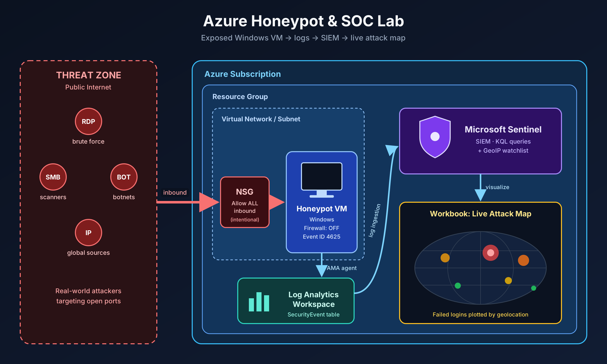
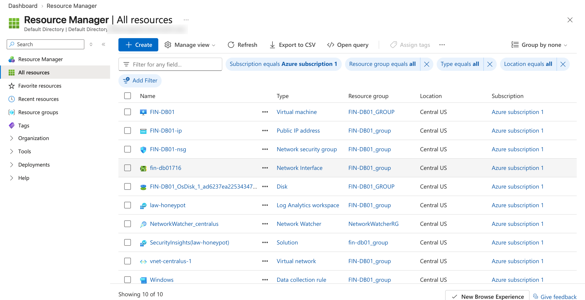
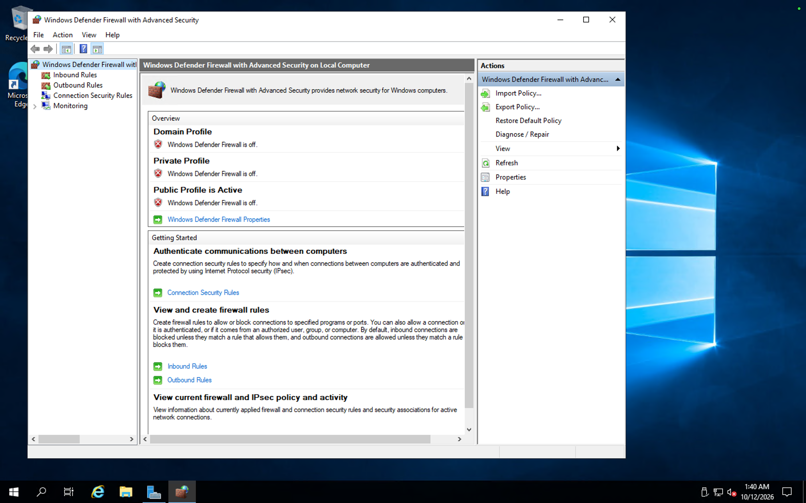
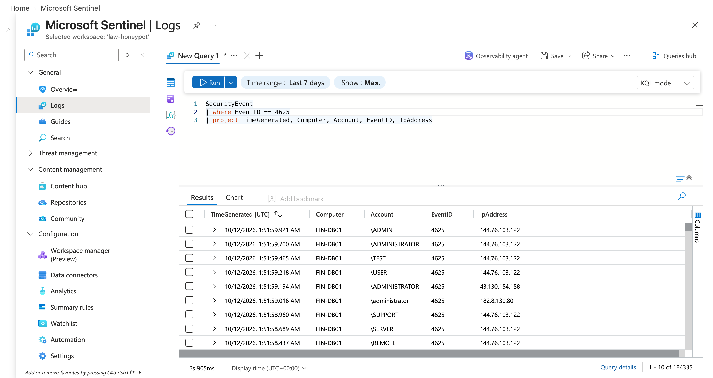
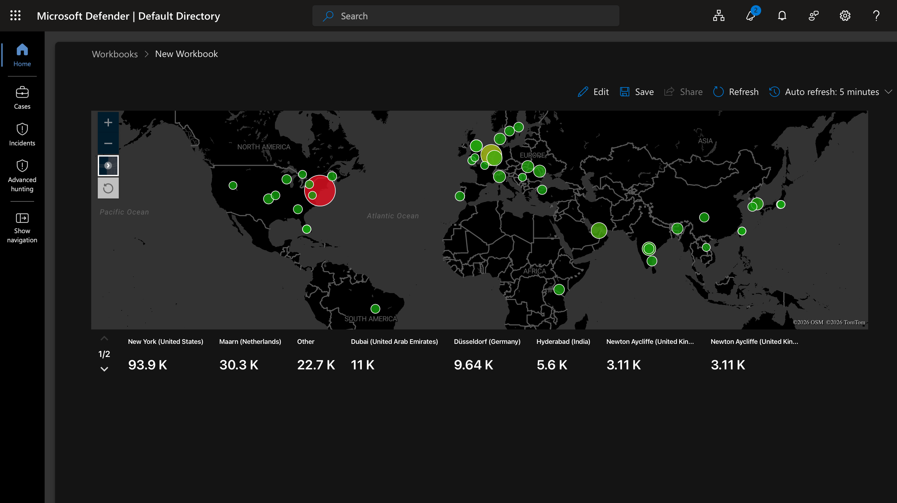

# Azure Honeypot & SOC Lab

A live honeypot on Microsoft Azure that attracted real-world attackers, with logs sent to **Microsoft Sentinel** (SIEM) and failed logins plotted on a global attack map.

**Result:** 184,000+ failed RDP login attempts captured from attackers around the world.

## Architecture



## Tools & Skills
- Microsoft Azure (Virtual Machines, NSGs, Virtual Networks)
- Log Analytics Workspace + Azure Monitor Agent
- Microsoft Sentinel (SIEM), Watchlists, Workbooks
- KQL (Kusto Query Language)
- Windows Security Event logs (Event ID 4625)

## How It Works
1. Deployed a Windows VM (`FIN-DB01`) in Azure.
2. Opened the Network Security Group to all inbound traffic and disabled the Windows Firewall, making the VM discoverable.
3. Forwarded Windows Security Events to a Log Analytics Workspace using the Azure Monitor Agent.
4. Connected Microsoft Sentinel and imported a GeoIP watchlist to map attacker IPs to locations.
5. Built a Sentinel workbook to visualize failed logins on a world map.

## Screenshots

### Azure resources


### Windows Firewall disabled on the VM


### Failed login events (Event ID 4625) in Sentinel


### Live attack map


## Attack Map Query (KQL)

```kql
let GeoIPDB_FULL = _GetWatchlist("geoip");
SecurityEvent
| where EventID == 4625
| evaluate ipv4_lookup(GeoIPDB_FULL, IpAddress, network)
| summarize FailureCount = count() by IpAddress, latitude, longitude, cityname, countryname
| project FailureCount, AttackerIp = IpAddress, latitude, longitude,
          city = cityname, country = countryname,
          friendly_location = strcat(cityname, " (", countryname, ")")
```

## Key Takeaways
- An exposed RDP port is found and brute-forced within minutes of going online.
- Attackers cycle through common usernames like `ADMINISTRATOR`, `ADMIN`, `TEST`, `USER`, and `SUPPORT`.
- A SIEM plus geolocation enrichment turns raw logs into readable threat intelligence.

## Cleanup
All resources were deleted after the lab to avoid ongoing costs and risk.
